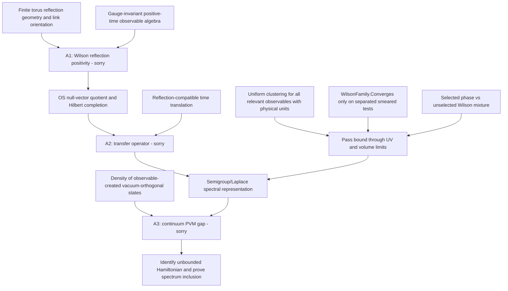

# Reflection positivity / mass-gap research scaffold

Status 2026-11-20: **not compiled, not proved**. This is an interface-oriented starting file, not a formal proof. Public sources were inspected through their GitHub HTML views; the GitHub MCP account rejected authentication and this runtime has no Lean/Lake installation.

## Exact upstream public imports

- `PublicTheory`: `GaugeGroup`, `HilbertSpace`, `EnergyMomentumMeasure`, `WightmanTheory`.
- `PublicWilson`: `Site`, `Configuration`, `plaquette`, `wilsonEnergy`, `wilsonLaw`, `WilsonFamily`, `WilsonFamily.Converges`.
- `ChallengeSpec`: `WilsonRegularity`, `Hierarchy`, `Hierarchy.Reconstructed`, `Hierarchy.Properties`, `JointExistence`.

`ChallengeSpec` imports `PublicWilson`; the scaffold therefore imports only `ChallengeSpec`.

## Dependency DAG (arrows mean prerequisite)



## Ranked analytic debts

1. **A3, very high:** Transfer exponential decay to the selected continuum phase without losing `m`; control smearing constants, contact exclusions, and possible renormalizations. Prove bounds for a separating/dense field algebra. Derive PVM support using spectral positivity, and identify generator `H`.
2. **A2, high:** Prove the OS form descends to the null quotient, the time-shift map preserves nulls, extends to the completed Hilbert space and is a positive self-adjoint contraction (where applicable). Identify this lattice quotient with the phase Hilbert space, or construct an independent compatible limit.
3. **A1, medium/high:** Implement the periodic link-reflection map, carefully handle links crossing the reflection plane and temporal wraparound, prove Wilson-action split/positive boundary kernel, establish measure invariance/integrability, and restrict to the genuine positive-time gauge-invariant cylinder algebra.

## Specification mismatches that cannot be skipped

- No public declaration `Hamiltonian H` was identified. `WightmanTheory.energyMomentum` is a projection-valued energy-momentum measure; `W0` asserts forward-cone support, not an isolated vacuum eigenvalue.
- `WilsonFamily.Converges` obtains a full mesh limit at fixed physical volume **then** a volume limit along a refined subsequence, for separated smeared insertions. It does not assert a uniform exponential two-point estimate, nor convergence of all unsmeared connected functions.
- `Hierarchy.Properties.wilson` identifies the **unselected** hierarchy's correlation with the Wilson family. `Hierarchy.Reconstructed.root` identifies analytic continuation with `some T.selected`. `Reconstructed.mixture` states the unselected correlation is an integral of selected-phase correlations. An upper bound on a mixture need not hold for each selected phase (phase cancellation, different low-energy supports).
- An arbitrary observable does not probe all excitation sectors. A gap theorem requires a dense family of centered local-state vectors, not one Wilson loop or a single plaquette observable.
- The periodic nearest-distance formula in `WilsonFamily.place` is not, by itself, a globally unambiguous time-reflection distance across the torus. Finite-volume temporal wraparound produces a second exponential contribution.
- A transfer matrix with discrete step `a` has eigenvalues `exp(-a E)` only after the correct time-step normalization. An index-unit bound `exp(-m n)` produces a physical gap `m/a`, not `m`; express decay in physical time `a n`.
- The bound `C * exp(-m r)` with a universal `C` for arbitrary unnormalized local observables is untenable under arbitrary scalar rescaling. Quantify a normalized bounded family or let prefactors depend on each observable but not `a` or `L`.
- `A1` currently receives `theta` and `positiveTime` from callers and `hGeometry : True` is a deliberate unfilled placeholder, **not proof of genuine reflection geometry**. `A2` receives `Q` and `hQIsOSQuotient : True` similarly. Both must be replaced by meaningful validated predicates before these theorem statements can be used mathematically.
- `#print axioms` for the three theorems is expected to list `sorryAx` until all analytical debts are eliminated. It cannot currently pass a no-nonstandard-axioms audit.

## Validation

Pinned upstream toolchain from the public repository: Lean 4.32.0. Place `MassGap/ReflectionPositivity.lean` under the repository root, then run:

```sh
lake exe cache get
lake build WilsonReference WilsonConstruction
lake env lean -j1 -DmaxHeartbeats=0 MassGap/ReflectionPositivity.lean
```

Expected current state: elaboration needs checking; if it succeeds, `#print axioms` exposes `sorryAx`. Do not claim completion on successful parsing or elaboration alone. Remove all placeholders, then repeat `#print axioms` for each target and audit the actual imported proof closures.

## Source pointers

- https://github.com/yang-mills-group/OpenAI-YM-20261028/blob/main/PublicTheory.lean
- https://github.com/yang-mills-group/OpenAI-YM-20261028/blob/main/PublicWilson.lean
- https://github.com/yang-mills-group/OpenAI-YM-20261028/blob/main/ChallengeSpec.lean
- https://github.com/scottnarmstrong/yang-mills-informalization

## Gaussian free-field control (2026-11-20)

See `MassGap/GaussianUFBI.md` for exact finite-dimensional Gaussian formulas, a verified numerical sweep, normalization audit, and the proposed boundary-to-central estimate. Reproduce using `python MassGap/GaussianUFBI.py`. This is evidence for evaluating a **hypothesized** UFBI condition, not an OS-reflection-positivity or mass-gap proof. Do not replace any A1/A2/A3 `sorry` with this numerical test.
